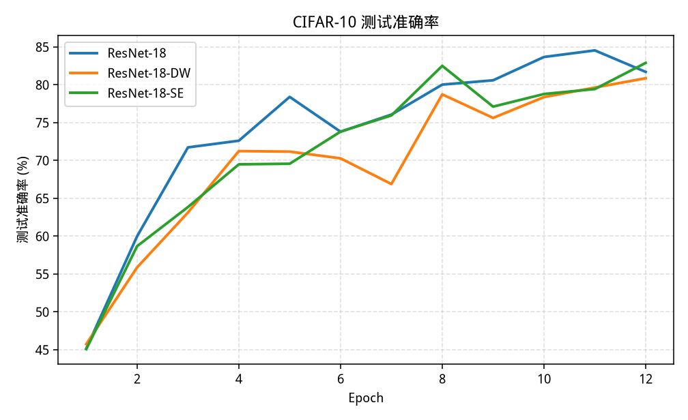
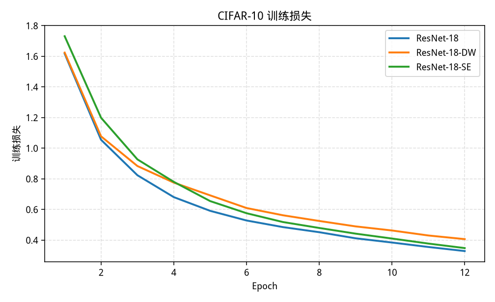
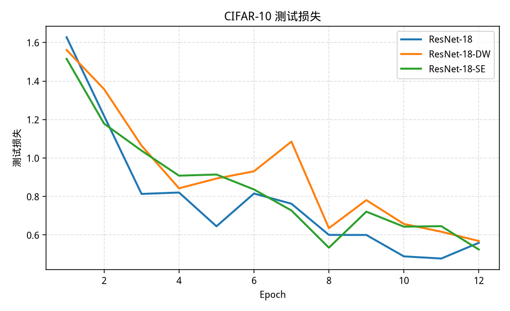
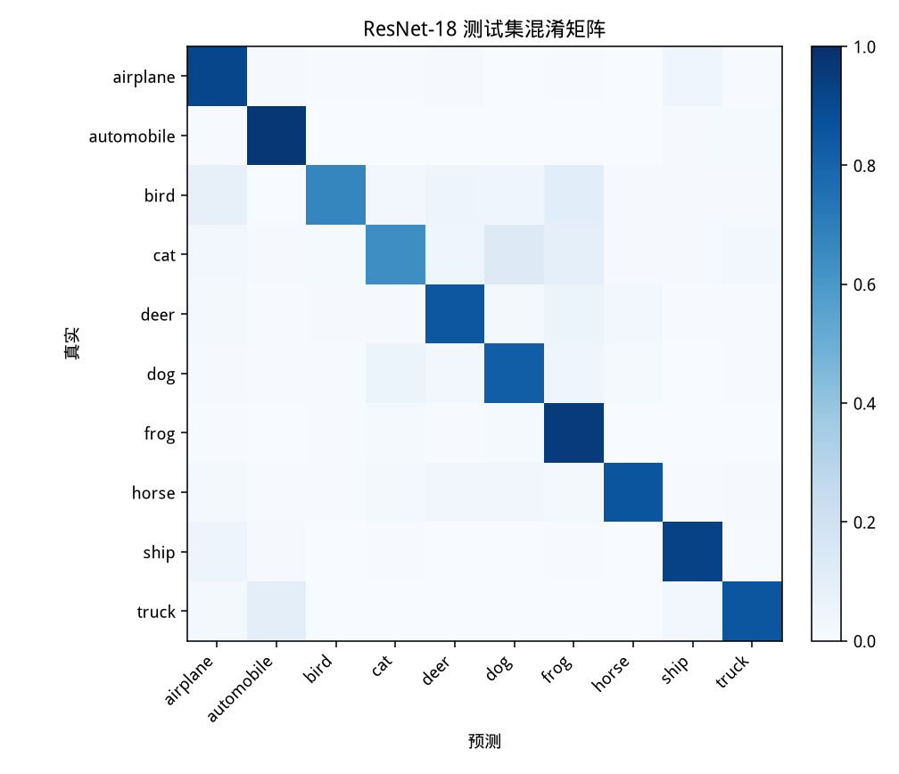
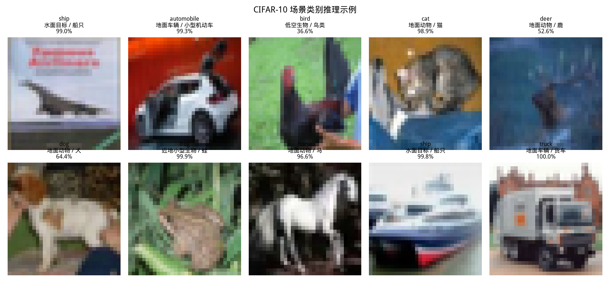

# CIFAR-10 图像分类：ResNet-18 及其结构变体

## 1. 任务说明

本实验做的是**图像分类**：每张图输出一个类别，不输出边界框，也没有检测头。数据集是 CIFAR-10，共 10 类、每张 32×32 彩色图，训练集 50000 张，测试集 10000 张。类别是 airplane、automobile、bird、cat、deer、dog、frog、horse、ship、truck。

基线是面向 CIFAR-10 改过的 ResNet-18：第一层用 3×3、stride 1 的卷积，后面不接 max-pool，然后是标准两层残差块。在同一训练配方下比较两种结构改动：

- 把残差块里的 3×3 卷积换成深度可分离卷积；
- 在残差支路加上 Squeeze-and-Excitation（SE）通道门控。

代码里还有把 ReLU 换成 GELU 的 `resnet18_gelu`，结构与统计脚本都已接好。本次缩短后的提交日志比较的是基线、深度可分离和 SE，这三项都有完整的 `metrics.csv`。GELU 没有单独的训练日志，报告里不写它的准确率。

场景部分把这 10 个类别看成户外画面里的粗粒度目标（飞行器、地面车辆、动物、船只），用训练好的权重对样例图做整图分类。这一步仍然只给类别，不做定位或跟踪。

报告中的准确率、损失、参数量和 MACs 都来自仓库里的日志和程序统计，不是手写估计。基线见 `runs/resnet18/`，深度可分离见 `runs/resnet18_dw/`，SE 见 `runs/resnet18_se/`。

## 2. 模型设计

### 2.1 基线 ResNet-18

输入经过 stem：`Conv 3×3, stride 1, padding 1, 3→64`，BatchNorm，ReLU。没有 max-pool，特征图仍是 32×32。

四个阶段各有 2 个 BasicBlock，通道数为 64、128、256、512。从第二个阶段开始，该阶段第一个块的 stride 为 2。空间尺寸因此是 32→16→8→4。最后做全局平均池化，再接 `Linear(512, 10)`。

每个 BasicBlock 是两层 3×3 卷积：

- 第一层 3×3 + BN + ReLU；
- 第二层 3×3 + BN；
- 若通道或尺寸变化，捷径用 1×1 卷积加 BN，否则是恒等映射；
- 相加后再经过 ReLU。

卷积用 Kaiming normal（`fan_out`，按 ReLU）初始化。每个残差块第二个 BN 的缩放初始化为 0，使恒等捷径的块在训练开始时接近恒等映射。

按 `train.py --print-stats` 的统计，基线参数量为 11,173,962。对一张 3×32×32 的图，Conv 与 Linear 的 MACs 为 555,422,720，FLOPs 按 2×MACs 计为 1,110,845,440。BN、激活和残差相加没有计入 MACs。

### 2.2 深度可分离卷积

`resnet18_dw` 只替换**残差块内部**的 3×3 卷积。每个 3×3 变成：

- depthwise 3×3（`groups = 输入通道`，只在每个通道内做空间混合）；
- pointwise 1×1（混合通道）。

外面的那一个 BN 和 ReLU 位置与基线相同。Stem 和 1×1 投影捷径仍是普通卷积。这样参数量和计算量的差别主要来自 3×3 被分解，而不是把整个网络换成另一种骨架。

该变体参数量为 1,439,626，是基线的 12.88%（1,439,626 / 11,173,962）。MACs 为 73,049,088，是基线的 13.15%（73,049,088 / 555,422,720）。FLOPs 为 146,098,176。

### 2.3 SE 通道注意力

`resnet18_se` 在第二个 BN 之后、与捷径相加之前插入 SE 模块，reduction 为 16。流程与 Hu 等人的做法一致：

1. 对每个通道做全局平均池化，得到长度为 C 的向量；
2. 用两个全连接层把通道压到 C/16 再还原，中间是 ReLU，输出经 Sigmoid；
3. 用这个门控逐通道缩放残差支路。

64 通道的隐层宽度是 4，128、256、512 依次是 8、16、32。SE 只增加这两层全连接的参数。相对基线，参数量增加 87,040，总参数量为 11,261,002；MACs 增加 87,040，总 MACs 为 555,509,760；FLOPs 为 1,111,019,520。增加的 MACs 等于增加的全连接参数量，因为门控作用在 1×1 的通道描述上。

### 2.4 代码中的 GELU 变体

`resnet18_gelu` 把 stem 和残差块里的 ReLU 换成 GELU，参数量与 MACs 与基线相同，初始化也不改。本报告的对比表不包含它的测试准确率，因为没有对应的训练日志。

## 3. 训练设置

数据用 torchvision 的 CIFAR-10。训练集做 `RandomCrop(32, padding=4)` 和 `RandomHorizontalFlip`，再按通道标准化，均值 `(0.4914, 0.4822, 0.4465)`，标准差 `(0.2023, 0.1994, 0.2010)`。测试集只做标准化。

优化器是 SGD，Nesterov 动量 0.9，权重衰减 `5e-4`，初始学习率 0.1，batch size 128。损失函数是交叉熵。学习率调度是 `CosineAnnealingLR`，周期 `T_max=24`，每个 epoch 的测试结束之后更新一次。随机种子是 42。

本次环境没有可用 GPU。`runs/*/config.json` 与 `summary.json` 中的设备都是 `cpu`，PyTorch 版本是 `2.15.0+cpu`，Python 是 3.12.3。训练步使用 bfloat16 autocast，测试准确率在 fp32 下计算，因此 `evaluate.py` 重新加载权重后应得到与日志相同的测试准确率。CPU 线程调度不保证逐位复现，报告以仓库里的 csv 为准。

基线最初按 24 个 epoch 启动。第 11 个 epoch 的测试准确率已经到 84.52%，高于 80% 的要求，于是在第 12 个 epoch 写完日志后停止，没有跑满 24 轮。深度可分离和 SE 直接训练 12 个 epoch，余弦周期同样是 24。因此在已经完成的 12 个 epoch 里，三个模型第 k 轮使用的学习率相同。例如第 1 轮都是 0.10000000，第 12 轮都是 0.05652631，见各自的 `metrics.csv`。因为在周期的中途停止，学习率还没有降到接近 0，后面没有低学习率的收尾阶段。

## 4. 实验结果

下表的参数量、MACs、FLOPs 来自各目录 `summary.json` 的 `complexity` 字段，准确率来自同一文件的 `best_test_acc` 与 `final_test_acc`。百分比保留两位小数，与 `metrics.csv` 中六位小数的测试准确率一致。

| 模型 | 参数量 | MACs | FLOPs | 最佳测试准确率 | 最佳 epoch | 末轮测试准确率 |
| --- | ---: | ---: | ---: | ---: | ---: | ---: |
| ResNet-18 | 11,173,962 | 555,422,720 | 1,110,845,440 | 84.52% | 11 | 81.68% |
| ResNet-18-DW | 1,439,626 | 73,049,088 | 146,098,176 | 80.84% | 12 | 80.84% |
| ResNet-18-SE | 11,261,002 | 555,509,760 | 1,111,019,520 | 82.87% | 12 | 82.87% |

第 1 轮测试准确率也直接来自 `history.json`：基线 45.13%，深度可分离 45.72%，SE 45.06%。三者都远高于 10% 的随机水平。基线在第 8 轮第一次达到 80.00%，最好成绩是第 11 轮的 84.52%。深度可分离在第 12 轮达到 80.84%。SE 的最好成绩是第 12 轮的 82.87%。

若干轮次的测试准确率如下，便于看收敛，而不是只看一个峰值。

| Epoch | 学习率 | ResNet-18 | ResNet-18-DW | ResNet-18-SE |
| ---: | ---: | ---: | ---: | ---: |
| 1 | 0.10000000 | 45.13% | 45.72% | 45.06% |
| 4 | 0.09619398 | 72.59% | 71.22% | 69.47% |
| 8 | 0.08043807 | 80.00% | 78.71% | 82.48% |
| 11 | 0.06294095 | 84.52% | 79.61% | 79.41% |
| 12 | 0.05652631 | 81.68% | 80.84% | 82.87% |

`evaluate.py` 重新加载三个 best checkpoint，在 10000 张测试图上得到的准确率与训练日志的差都是 0：基线仍是 84.52%，深度可分离仍是 80.84%，SE 仍是 82.87%。曲线由 `plot_curves.py` 根据 `history.json` 画出。







基线 12 个 epoch 的训练加测试时间为 2061.7 秒，这是 `metrics.csv` 里 `train_seconds` 与 `test_seconds` 之和。其中第 12 轮的训练时间为 257.313 秒，明显高于其余轮次的 138.602–150.513 秒。深度可分离 12 轮的进程计时是 1786.3 秒（`summary.json` 的 `total_train_seconds_this_process`）。单轮训练时间大多在 129–133 秒，并没有按 MACs 缩小到大约七分之一。

SE 的 `total_train_seconds_this_process` 是 2299.2 秒。它的第 7 轮训练时间是 365.860 秒，明显高于其余轮次大约 150 秒的水平，和第 12 轮测试的 42.084 秒一样，都按日志原样保留。

## 5. 结果分析

基线在这个短日程上已经明显高于随机猜测。第 1 轮测试准确率 45.13%，第 8 轮 80.00%，第 11 轮 84.52%。第 12 轮训练准确率升到 88.79%，测试准确率却回到 81.68%，测试损失从第 11 轮的 0.4778 升到 0.5595。这是一次测试集上的波动：权重仍以第 11 轮为准保存。由于余弦周期设成 24 而实际只训了 12 轮，学习率停在 0.0565 左右，模型没有经历学习率接近 0 的那一段。若把周期跑满，测试准确率还有可能再升高；本报告不把没有跑过的轮次算进结果。

深度可分离卷积把参数量降到基线的 12.88%，MACs 降到 13.15%。第 1 轮测试准确率 45.72%，与基线的 45.13% 几乎一样。随后基线拉开差距：第 8 轮基线 80.00%、深度可分离 78.71%；第 11 轮是 84.52% 对 79.61%。到第 12 轮，两者又接近，分别是 81.68% 和 80.84%。按各自最好的 checkpoint 比较，深度可分离低 3.68 个百分点（80.84% 对 84.52%），但仍然过了 80%。在这个 CIFAR stem 的 ResNet-18 里，把残差块的 3×3 分解成 depthwise 加 pointwise，主要牺牲的是中间若干轮的测试准确率，12 轮结束时的差距小于峰值差距。

墙钟时间没有按计算量同比下降。深度可分离的典型训练轮次大约 130 秒，基线除偏慢的第 12 轮外大约 140–150 秒。PyTorch 在这台 4 核 CPU 上对小特征图的分组卷积并不像稠密 3×3 那样吃满算力，所以 MACs 表格里的 7 倍差距没有变成 7 倍的训练加速。比较效率时应以日志中的 MACs 和实测秒数同时看，不能只用其中一项。

SE 相对基线只多 87,040 个参数和同样数量的 MACs。最好测试准确率是 82.87%（第 12 轮），比基线最好的 84.52% 低 1.65 个百分点。若改成比较同一个 epoch，结论会换方向：第 8 轮 SE 是 82.48%，基线是 80.00%；第 12 轮 SE 是 82.87%，基线是 81.68%。第 11 轮则是基线更高（84.52% 对 79.41%）。因此在这 12 轮里，SE 没有稳定地超过基线的最佳 checkpoint，两条曲线是交叉的。额外的通道门控在这个尚未把学习率退火完的短日程上，没有带来可以单凭一个峰值就写成“提升”的差距。

## 6. 场景应用

CIFAR-10 的标签被读成户外画面中的粗类别，只用于说明分类结果，不改变训练数据。

| 数据集类别 | 场景读法 | 粗分组 |
| --- | --- | --- |
| airplane | 空中目标 / 飞行器 | 空中 |
| automobile | 地面车辆 / 小型机动车 | 地面车辆 |
| bird | 低空生物 / 鸟类 | 动物 |
| cat | 地面动物 / 猫 | 动物 |
| deer | 地面动物 / 鹿 | 动物 |
| dog | 地面动物 / 犬 | 动物 |
| frog | 近地小型生物 / 蛙 | 动物 |
| horse | 地面动物 / 马 | 动物 |
| ship | 水面目标 / 船只 | 水面 |
| truck | 地面车辆 / 货车 | 地面车辆 |

`samples/` 里每类一张图，来自 CIFAR-10 测试集中该类的第一张，索引写在 `samples/manifest.json`。例如 `00_airplane.png` 是测试集下标 3，标签为 airplane。推理脚本加载 checkpoint，用与测试集相同的标准化，输出类别、概率和上表中的场景读法。

```bash
python infer_demo.py --checkpoint checkpoints/resnet18_best.pth --image samples/00_airplane.png
python infer_demo.py --checkpoint checkpoints/resnet18_best.pth --samples-dir samples --save-json artifacts/demo_predictions.json --save-grid artifacts/demo_grid.png
```

演示输出是整张图的一个类别。它不画框，也不做检测。用基线第 11 轮的权重跑 `samples/` 的 10 张图，结果写在 `artifacts/demo_predictions.json`。其中 9 张预测正确。`00_airplane.png` 的真实标签是 airplane，模型却把它判成 ship，概率 99.05%。`02_bird.png` 虽然判对，概率只有 36.56%。其余样例的概率从 deer 的 52.58% 到 truck 的 99.99%。单张 32×32 的例子不能代表测试集，下面的每类准确率才是整份测试集的统计。

基线 checkpoint 在 `runs/resnet18/eval.json` 里的每类准确率（每类 1000 张）：

| 类别 | 准确率 | 正确数 |
| --- | ---: | ---: |
| airplane | 91.20% | 912 |
| automobile | 97.00% | 970 |
| bird | 66.90% | 669 |
| cat | 64.00% | 640 |
| deer | 85.00% | 850 |
| dog | 82.20% | 822 |
| frog | 95.40% | 954 |
| horse | 85.60% | 856 |
| ship | 92.70% | 927 |
| truck | 85.20% | 852 |

鸟和猫是基线上最弱的两类。基线的总体准确率更高，并不表示每个类别都更好：深度可分离模型的猫有 85.00%（850/1000），高于基线的 64.00%，但狗只有 46.80%（468/1000），见 `runs/resnet18_dw/eval.json`。

基线的归一化混淆矩阵由 `plot_curves.py` 根据 `runs/resnet18/eval.json` 画出。行是真实类别，列是预测类别。





## 7. 结论

在 CIFAR-10 上从零训练的 ResNet-18，使用 3×3 stride-1 的 stem、标准残差块、12 个 epoch、余弦周期 24、CPU 上的 bfloat16 训练步，最好测试准确率是 84.52%（第 11 轮）。把残差块中的 3×3 换成深度可分离卷积后，参数量为 1,439,626，MACs 为 73,049,088，最好测试准确率是 80.84%（第 12 轮）。精度下降有限，实测单轮时间却没有按 MACs 成比例下降。加上 SE 之后参数量为 11,261,002，最好测试准确率是 82.87%（第 12 轮），与基线的差距随比较的 epoch 而变号，不能写成稳定的提升。三个模型的第 1 轮测试准确率分别是 45.13%、45.72% 和 45.06%，训练过程是真实发生的。

## 8. 复现

```bash
python -m venv .venv
source .venv/bin/activate
pip install -r requirements.txt
EPOCHS=12 T_MAX=24 WORKERS=0 AMP=bf16 bash scripts/train_all.sh
```

`requirements.txt` 使用 CPU 版 PyTorch。机器上有 CUDA 时，可以改用对应的 CUDA 轮子，`train.py` 会自动使用 GPU。官方 CIFAR-10 地址有时很慢，可将 MD5 为 `c58f30108f718f92721af3b95e74349a` 的 `cifar-10-python.tar.gz` 放到 `data/` 后再启动。

只重算测试集：

```bash
python evaluate.py --all
python plot_curves.py
```

生成报告 PDF（需要系统里有文泉驿微米黑或 Droid Sans Fallback）：

```bash
python tools/render_report_pdf.py
```

## 9. 参考文献

1. He K, Zhang X, Ren S, Sun J. Deep Residual Learning for Image Recognition. CVPR, 2016.
2. Hu J, Shen L, Sun G. Squeeze-and-Excitation Networks. CVPR, 2018.
3. Howard A G, Zhu M, Chen B, et al. MobileNets: Efficient Convolutional Neural Networks for Mobile Vision Applications. arXiv:1704.04861, 2017.
4. Hendrycks D, Gimpel K. Gaussian Error Linear Units (GELUs). arXiv:1606.08415, 2016.
5. Krizhevsky A. Learning Multiple Layers of Features from Tiny Images. Technical report, 2009.
